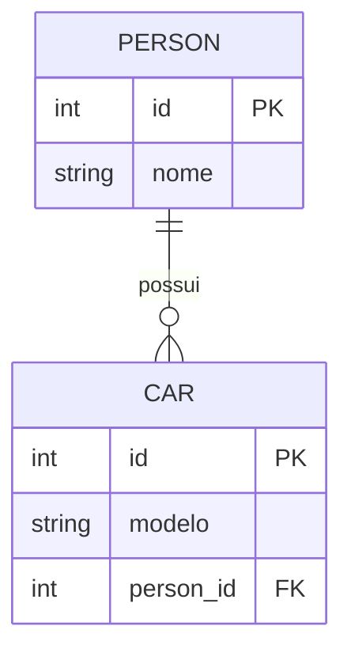

# Relacionamentos em Orientação a Objetos, UML e Banco de Dados

## 1. Conceito de Cardinalidade
Cardinalidade define quantas instâncias de uma entidade podem ou devem se relacionar com outra entidade.

Em outras palavras, a cardinalidade responde à pergunta: *"Quantos objetos de uma classe podem estar associados a objetos de outra classe?"*

Repare que a cardinalidade não permite que a FK fique sempre apenas no lado do muitos. Ela indica a regra do relacionamento. Porém, em um relacionamento $1:N$ (One-to-Many), a modelagem relacional tradicional coloca a FK obrigatoriamente no lado $N$. Ela é representada na UML próxima às extremidades do relacionamento.

### 1.1 Relacionamento $1:N$ (Um para Muitos)
```text
Pessoa 1 ---------------- 0..N Carro
```
**Leitura:**
- Uma Pessoa pode possuir zero ou vários Carros.
- Um Carro pertence a uma única Pessoa.

**Modelo correto no banco (A FK fica no lado $N$):**



#### 📋 PERSON
Representa a entidade de usuários/pessoas no sistema.

| Coluna | Tipo | Restrições | Descrição |
| :--- | :--- | :--- | :--- |
| `id` | INT | PK | Identificador único |
| `nome` | VARCHAR | NOT NULL | Nome da pessoa |

#### 🚗 CAR
Representa os veículos associados às pessoas.

| Coluna | Tipo | Restrições | Descrição |
| :--- | :--- | :--- | :--- |
| `id` | INT | PK | Identificador único do carro |
| `modelo` | VARCHAR | NOT NULL | Modelo do veículo |
| `person_id` | INT | FK | Chave estrangeira referenciando `PERSON(id)` |

> **Relacionamento:** Uma `PERSON` pode possuir vários `CAR` ($1:N$).

#### Script SQL:
```sql
CREATE TABLE person (
    id BIGSERIAL PRIMARY KEY,
    name VARCHAR(100) NOT NULL
);

CREATE TABLE car (
    id BIGSERIAL PRIMARY KEY,
    model VARCHAR(100) NOT NULL,
    person_id BIGINT,

    CONSTRAINT fk_car_person
        FOREIGN KEY (person_id)
        REFERENCES person(id)
);
```

---

### 1.2 Quando a FK fica nos dois lados?
Normalmente em um relacionamento $1:1$.

```text
Pessoa 1 ---------------- 1 Passaporte
```
- Uma pessoa possui um passaporte.
- Um passaporte pertence a uma pessoa.

Aqui existe a possibilidade de colocar a FK em qualquer uma das tabelas.

**Opção 1 - FK no Passaporte (mais comum):**

#### PERSON
```text
id
nome
```

#### PASSPORT
```text
id
number
person_id FK
```

#### Script SQL Correspondente:
```sql
CREATE TABLE person (
    id BIGSERIAL PRIMARY KEY,
    nome VARCHAR(100) NOT NULL
);

CREATE TABLE passport (
    id BIGSERIAL PRIMARY KEY,
    number VARCHAR(50) NOT NULL,
    person_id BIGINT UNIQUE, -- O UNIQUE garante a relação 1:1

    CONSTRAINT fk_passport_person
        FOREIGN KEY (person_id)
        REFERENCES person(id)
);
```

---

## 2. Principais Símbolos de Cardinalidade

### 2.1 Um ($1$)
Representa exatamente uma ocorrência.
* Exemplo: `Pessoa 1` (Deve existir exatamente uma Pessoa).

### 2.2 Zero ou um ($0..1$)
Representa uma relação opcional.
* Exemplo: `Pessoa 0..1` (Pode existir uma Pessoa ou pode não existir nenhuma). Uma pessoa pode ou não possuir um passaporte (`Pessoa 1 -------- 0..1 Passaporte`).

### 2.3 Muitos ($N$)
Representa várias ocorrências.
* Exemplo: `Livro 0..N` (Pode existir nenhum livro ou vários livros).

### 2.4 Zero ou muitos ($0..*$) — Também escrito como $0..N$
* O relacionamento é opcional.
* Pode não existir nenhum registro ou existir vários registros.
* Exemplo: Um autor pode ter nenhum livro cadastrado ou vários (`Autor 1 -------- 0..N Livro`).

### 2.5 Um ou muitos ($1..*$)
* Deve existir pelo menos um registro.
* Exemplo: Um pedido precisa possuir pelo menos um item (`Pedido 1 -------- 1..N ItemPedido`). Não existe pedido vazio.

---

## 3. Cardinalidade e Participação
A cardinalidade possui dois conceitos:
* **Mínimo:** Quantidade mínima obrigatória ($0$ = Opcional, $1$ = Obrigatório).
* **Máximo:** Quantidade máxima permitida ($1$ = Somente um, $N$ ou $*$ = Vários).

---

## 4. Leitura Correta de um Relacionamento
A leitura deve ser feita dos dois lados.
* Exemplo: `Pessoa 1 ---------------- 0..N Carro`
   * *Lendo da esquerda para direita:* Uma Pessoa pode possuir zero carros ou vários carros.
   * *Lendo da direita para esquerda:* Um Carro pertence a exatamente uma Pessoa.

---

## 5. Cardinalidade e Chave Estrangeira (FK)
A cardinalidade é o principal fator que define onde a chave estrangeira será colocada.
* **Regra geral:** A chave estrangeira fica no lado que pode possuir várias ocorrências (lado *MANY*).

---

## 6. Relacionamento One-to-Many ($1:N$)
* **Exemplo:** `Autor 1 ---------------- 0..N Livro`
* **Significado:** Um Autor pode ter vários Livros / Um Livro possui um único Autor.
* **Banco:** A FK fica em `BOOK` porque `BOOK` é o lado *MANY*.

---

## 7. Relacionamento Many-to-One ($N:1$)
É o mesmo relacionamento observado pelo lado oposto (`Livro N ---------------- 1 Autor`). A FK continua em `BOOK.author_id`. Mesmo mudando o ponto de vista, a estrutura do banco não muda.

---

## 8. Relacionamento One-to-One ($1:1$)
* **Exemplo:** `Pessoa 1 ---------------- 1 Passaporte`
* **Banco:** Pode ser em qualquer lado, normalmente na entidade dependente (`DOCUMENT.person_id`).

---

## 9. Relacionamento Many-to-Many ($N:N$)
* **Exemplo:** `Aluno N ---------------- N Curso`
* **Motivo:** Não é possível colocar a FK diretamente em nenhuma das tabelas. A solução é criar uma **tabela intermediária** que representa o relacionamento.

---

## 10. Cardinalidade na Composição e Agregação
* **O diamante preto e branco NÃO definem a FK.** Eles representam apenas o tipo de dependência. Quem define a FK continua sendo a cardinalidade.
* **Exemplo Composição (`Pedido 1 ◆──────── 1..N ItemPedido`):** A FK fica em `ItemPedido` porque é o lado $N$.
* **Exemplo Agregação (`Departamento 1 ◇──────── 0..N Funcionário`):** Mesmo sendo agregação, a FK continua no lado $N$.

---

## 11. Regra de Ouro
1. **Passo 1:** Observe a cardinalidade (ex: `Cliente 1 -------- N Pedido`).
2. **Passo 2:** Procure o lado *MANY* (Neste caso: `Pedido`).
3. **Passo 3:** Coloque a FK no lado *MANY* (`PEDIDO.cliente_id FK`).

---

## 12. Resumo das Cardinalidades

| Cardinalidade | Significado | Exemplo | Local da FK |
| :--- | :--- | :--- | :--- |
| **1:1** | Um para um | Pessoa e Passaporte | Qualquer lado |
| **1:N** | Um para muitos | Autor e Livro | Lado $N$ |
| **N:1** | Muitos para um | Livro e Autor | Lado $N$ |
| **N:N** | Muitos para muitos | Aluno e Curso | Tabela intermediária |
| **0..1** | Opcional único | Pessoa e Passaporte | Depende |
| **0..N** | Opcional muitos | Autor e Livro | Lado $N$ |
| **1..N** | Obrigatório muitos | Pedido e Item | Lado $N$ |

---

## 13. Tipos de Relacionamentos na UML e no Banco

### 1. Associação
* **Conceito:** Relacionamento mais simples. Um objeto conhece ou utiliza outro. As duas classes podem existir separadamente (`Pessoa 1 -------- 0..N Carro`).
* **Banco:** A FK fica em Carro. Nunca haverá uma FK em Person apontando para Carro.

### 2. Associação Unidirecional
* **Conceito:** Apenas uma classe conhece a outra (`Pedido --------> Cliente`). Na UML aparece uma seta.
* **Banco:** Não muda absolutamente nada. A seta da UML **NÃO** muda onde fica a chave estrangeira.

### 3. Associação Bidirecional
* **Conceito:** As duas classes conhecem uma à outra (`Autor -------- Livro`).
* **Banco:** Também não muda. Existe apenas **uma** FK.

### 4. Agregação
* **Conceito:** Representa uma relação "tem um" (*HAS-A*) com dependência fraca (`Departamento ◇──── Funcionário`). Diamante branco.
* **Banco:** Nenhuma regra especial. Funciona igual a uma associação.

### 5. Composição
* **Conceito:** Representa um *HAS-A* com dependência forte (`Pedido ◆──── ItemPedido`). Diamante preto. Se o objeto principal for destruído, os filhos também deixam de existir.
* **Banco:** A FK continua no lado filho. Utiliza-se geralmente `CascadeType.ALL` ou `CascadeType.REMOVE`.

### 6. Dependência
* **Conceito:** Relacionamento mais fraco da UML. Uma classe utiliza outra temporariamente (`PessoaService ------> EmailService`). Linha tracejada.
* **Banco:** Nenhuma tabela é alterada. Nenhuma FK.

### 7. Generalização / Herança (IS-A)
* **Conceito:** `Livro É UM Produto`. Seta com triângulo branco.
* **Banco:** Depende da estratégia de herança (`SINGLE_TABLE`, `JOINED`, `TABLE_PER_CLASS`).

### 8. Realização (Interfaces)
* **Conceito:** A classe implementa uma interface (`Cartão implements Pagável`). Triângulo branco + linha tracejada.
* **Banco:** Nenhuma alteração. Interface não gera tabela.

---

## 14. Resumo Geral (UML vs Banco)

| Relacionamento | UML | Dependência | Precisa FK? | Onde fica a FK? |
| :--- | :--- | :--- | :--- | :--- |
| **Associação** | Linha simples | Não | Sim | Lado $N$ ou dependente |
| **Associação Unidirecional** | Linha + seta | Não | Sim | Lado $N$ |
| **Associação Bidirecional** | Linha | Não | Sim | Apenas no lado $N$ |
| **Agregação** | Diamante branco | Fraca | Sim | Lado $N$ ou dependente |
| **Composição** | Diamante preto | Forte | Sim | Lado filho |
| **Dependência** | Linha tracejada | Muito fraca | Não | Não existe |
| **Herança (IS-A)** | Triângulo branco | Não é composição | Depende da estratégia | Não segue regra de FK comum |
| **Interface** | Triângulo + tracejado | Não | Não | Não existe |
| **One-to-One** | Associação | Depende | Sim | Um dos lados |
| **One-to-Many** | Associação | Não | Sim | Sempre no *MANY* |
| **Many-to-One** | Associação | Não | Sim | Sempre no *MANY* |
| **Many-to-Many** | Associação | Não | Sim | Tabela intermediária |

---

## Observações Finais
1. **UML e Banco de Dados não são a mesma coisa:** A UML representa como os objetos se relacionam em memória; o banco de dados representa como as informações são armazenadas.
2. **O diamante NÃO muda onde fica a chave estrangeira:** Ele representa apenas o nível de dependência.
3. **A cardinalidade define onde fica a chave estrangeira:** É a regra de ouro da modelagem relacional.